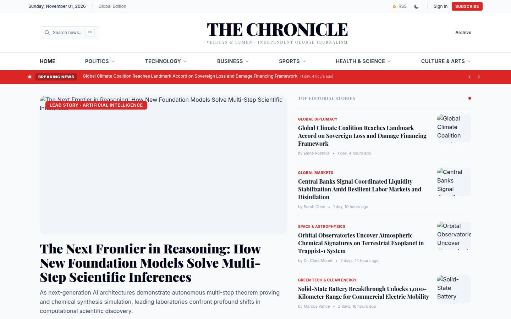
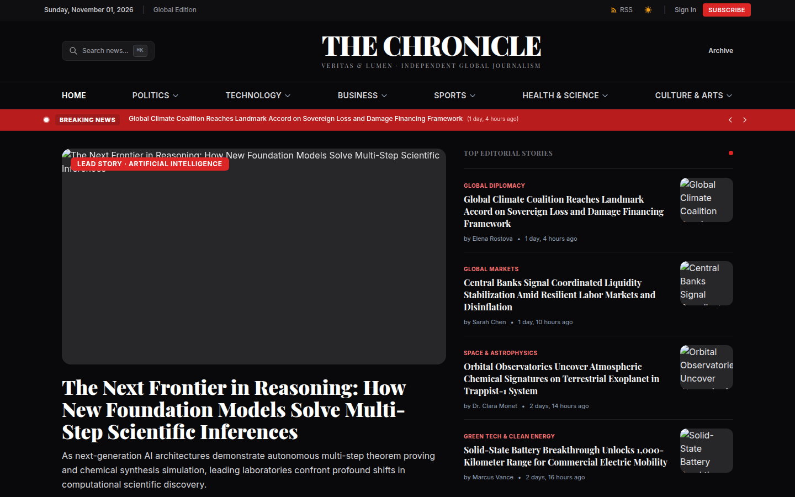
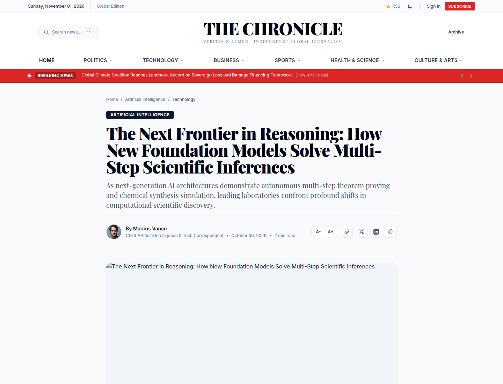
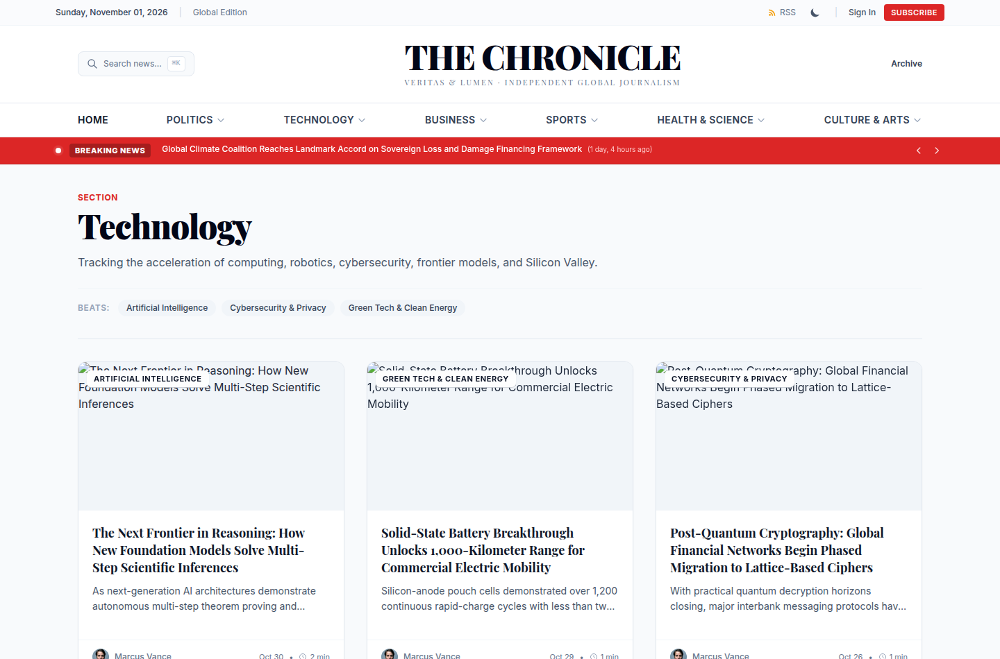
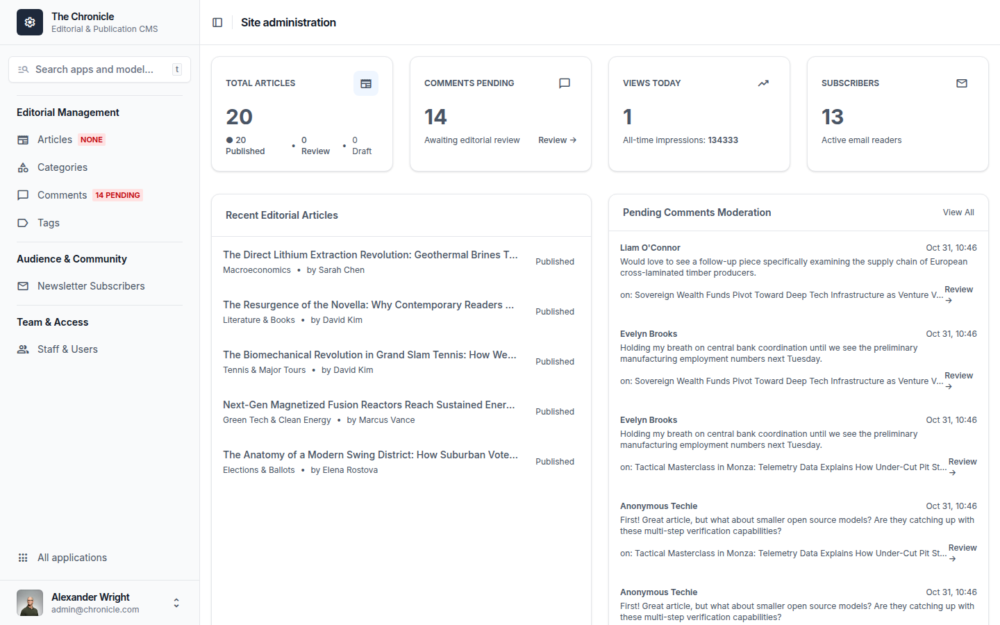
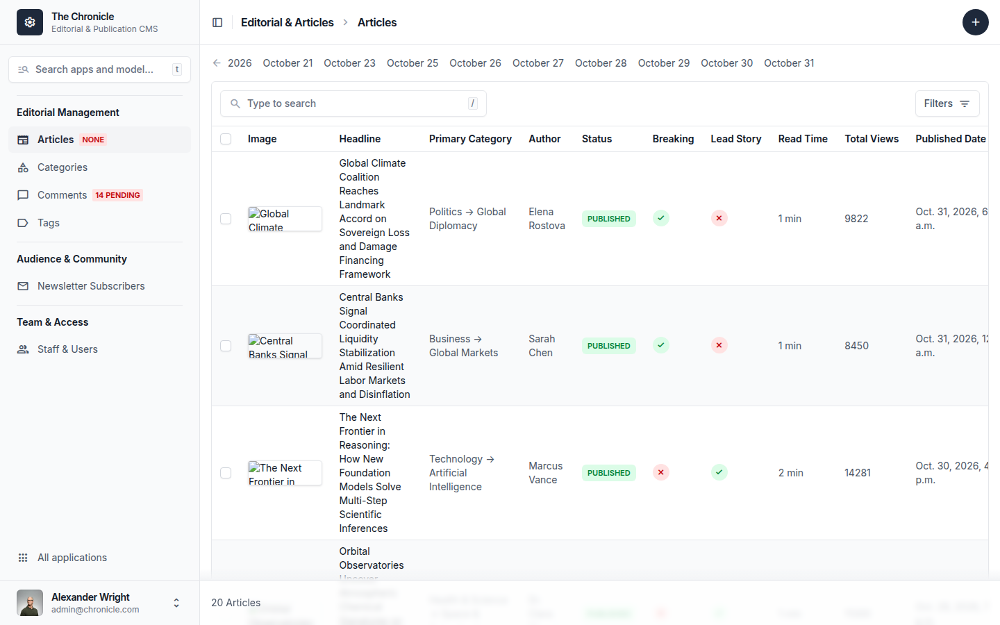

# The Chronicle — Modern Editorial News Platform

[](https://www.djangoproject.com/)
[](https://www.python.org/)
[](#-1-command-docker-quickstart)
[](#-ai-editorial-assistant--copilot)
[](https://tailwindcss.com/)
[](https://github.com/lukas-blehr/django-unfold)
[](https://www.postgresql.org/)
[](LICENSE.md)
[](https://7azzani.com/donation/)

**The Chronicle** is a production-grade, editorial-standard digital journalism platform engineered with **Django 5.1** and **Python 3.12**. Inspired by modern publications such as *The New York Times*, *The Verge*, and the *BBC*, it delivers an editorial aesthetic, accessible typography, dynamic publishing workflows, a Tailwind-powered admin panel via **Django Unfold**, dark/light mode switching, full search and taxonomy filtering, and deployment configurations.

---

## 📸 Visual Showcase & Screenshots

Experience **The Chronicle**'s modern editorial aesthetic across frontend and backend interfaces:

### 🌟 Editorial Frontend Experience

| ☀️ Editorial Homepage (Light Mode) | 🌙 Editorial Homepage (Dark Mode) |
| :---: | :---: |
|  |  |

| 📖 Long-form Article Reading Experience | ⚡ Technology Archive & Subcategory Grid |
| :---: | :---: |
|  |  |

### 🛠️ Professional Django Admin Panel (Powered by Unfold)

| 📊 Unfold Dashboard with Real-time KPI Widgets | 📱 Mobile-First Responsive Layout |
| :---: | :---: |
|  |  |

| 📝 Editorial Publishing Workflow & Moderation Queue |
| :---: |
|  |

---

## Table of Contents
1. [Visual Showcase & Screenshots](#-visual-showcase--screenshots)
2. [Tech Stack & Architecture](#tech-stack--architecture)
3. [Project Directory Structure](#project-directory-structure)
4. [Core Feature Highlights](#core-feature-highlights)
5. [1-Command Docker Quickstart](#-1-command-docker-quickstart)
6. [Local Development Quickstart](#local-development-quickstart)
7. [AI Editorial Assistant & Copilot](#-ai-editorial-assistant--copilot)
8. [Audience & Newsletter Email Dispatcher](#-audience--newsletter-email-dispatcher)
9. [Scheduled Publishing Automation](#-scheduled-publishing-automation)
10. [Seed Data & Demo Accounts](#seed-data--demo-accounts)
11. [Django Admin with Unfold](#django-admin-with-unfold)
12. [Design System & Dark Mode](#design-system--dark-mode)
13. [Tailwind CSS Build Setup](#tailwind-css-build-setup)
14. [Comprehensive Ubuntu Production Deployment Guide](#comprehensive-ubuntu-production-deployment-guide)
   - [Phase 1: Server Provisioning & Non-Root User](#phase-1-server-provisioning--non-root-user)
   - [Phase 2: SSH Hardening & UFW Firewall](#phase-2-ssh-hardening--ufw-firewall)
   - [Phase 3: PostgreSQL Database Setup](#phase-3-postgresql-database-setup)
   - [Phase 4: Application Deployment & Permissions](#phase-4-application-deployment--permissions)
   - [Phase 5: Gunicorn Systemd Service & Socket](#phase-5-gunicorn-systemd-service--socket)
   - [Phase 6: Nginx Reverse Proxy & HTTP/2](#phase-6-nginx-reverse-proxy--http2)
   - [Phase 7: SSL Certificate Automation with Let's Encrypt](#phase-7-ssl-certificate-automation-with-lets-encrypt)
   - [Phase 8: Automated Zero-Downtime Deploy Script](#phase-8-automated-zero-downtime-deploy-script)
15. [Automated Testing & Quality Assurance](#automated-testing--quality-assurance)
16. [License & Mandatory Attribution](#license--mandatory-attribution)
17. [Support & Next Open-Source Projects](#-support-the-creator--request-the-next-project)

---

## Tech Stack & Architecture

- **Backend Framework**: Django 5.1 LTS with Python 3.12.
- **Modern Admin Panel**: `django-unfold` (Tailwind-based admin UI with custom dashboards, badge callbacks, and styled widgets).
- **Rich Text Authoring**: `django-ckeditor-5` (clean WYSIWYG build with image uploads, table formatting, and code blocks).
- **Frontend Architecture**: Django Template Engine + TailwindCSS (responsive mobile-first layout, custom typography, dark/light theme toggle).
- **Database Layer**: PostgreSQL in production with automatic SQLite fallback for zero-friction local development.
- **Static & Media Asset Delivery**: `whitenoise` with compressed and hashed manifest storage + Pillow for image processing and banner rendering.
- **Application Server & Proxy**: Gunicorn (gthread workers) + Nginx reverse proxy with HTTP/2 and gzip compression.
- **Environment Management**: `python-decouple` reading from `.env` files.
- **Taxonomy & Tags**: `django-taggit` with case-insensitive tag matching.
- **SEO & Syndication**: Dynamic XML Sitemaps, RSS 2.0 Syndication Feed, Open Graph & Twitter Cards, Schema.org `NewsArticle` JSON-LD structured data.

---

## Project Directory Structure

```text
chronicle-news/
├── manage.py                          # Django CLI utility
├── requirements.txt                   # Production Python package requirements
├── package.json                       # Tailwind build configuration & scripts
├── tailwind.config.js                 # Tailwind CSS theme & plugin settings
├── .env.example                       # Reference environment variables
├── .env                               # Local environment configuration
├── README.md                          # Documentation & deployment guide
├── docs/
│   └── screenshots/                   # High-resolution platform interface screenshots
├── deploy/
│   ├── gunicorn.service               # Systemd application service
│   ├── gunicorn.socket                # Systemd socket unit
│   ├── nginx.conf                     # Production Nginx reverse proxy configuration
│   └── deploy.sh                      # Zero-downtime automated deployment script
├── news_project/
│   ├── __init__.py
│   ├── asgi.py                        # ASGI application interface
│   ├── wsgi.py                        # WSGI application interface
│   ├── urls.py                        # Root URL routing & syndication
│   └── settings/
│       ├── __init__.py                # Environment-aware selector
│       ├── base.py                    # Shared configuration, apps, Unfold, CKEditor
│       ├── dev.py                     # Development settings (debug, SQLite fallback)
│       └── prod.py                    # Production settings (SSL, HSTS, security headers)
├── apps/
│   ├── __init__.py
│   ├── core/                          # User accounts, auth & admin dashboard
│   │   ├── admin.py                   # Unfold custom UserAdmin
│   │   ├── admin_dashboard.py         # Real-time KPI callbacks for Unfold
│   │   ├── apps.py
│   │   ├── forms.py                   # Registration & email auth forms
│   │   ├── models.py                  # CustomUser (roles, bio, avatar, social handles)
│   │   ├── tests.py                   # CustomUser test cases
│   │   └── views.py                   # Auth views & robots.txt
│   ├── articles/                      # News articles, taxonomy & moderation
│   │   ├── admin.py                   # Unfold ArticleAdmin with publishing actions & inlines
│   │   ├── apps.py
│   │   ├── context_processors.py      # Global categories, breaking news & trending items
│   │   ├── feeds.py                   # RSS 2.0 Syndication feed
│   │   ├── forms.py                   # Comment submission with honeypot & search filters
│   │   ├── models.py                  # Category, Article, Comment, ArticleView
│   │   ├── sitemaps.py                # XML Sitemap generators
│   │   ├── tests.py                   # Article and moderation test cases
│   │   ├── urls.py                    # Article URL patterns
│   │   ├── views.py                   # Home, Detail, Category, Tag, Author, Search
│   │   └── management/
│   │       └── commands/
│   │           └── seed_news.py       # Seed generator with articles, categories, comments
│   └── newsletter/                    # Audience & subscription management
│       ├── admin.py                   # Unfold NewsletterSubscriberAdmin with CSV export
│       ├── apps.py
│       ├── forms.py                   # Email signup form with bot honeypot
│       ├── models.py                  # NewsletterSubscriber model
│       ├── tests.py                   # Newsletter subscription & unsubscribe tests
│       ├── urls.py
│       └── views.py                   # Subscribe & Unsubscribe views
├── templates/
│   ├── base.html                      # Core HTML5 layout, Tailwind setup & dark mode head script
│   ├── 403.html                       # Styled 403 Forbidden page
│   ├── 404.html                       # Styled 404 Not Found page
│   ├── 500.html                       # Styled 500 Server Error page
│   ├── admin/
│   │   ├── index.html                 # Unfold admin dashboard template override
│   │   └── dashboard_widgets.html     # Real-time KPI cards & recent activity
│   ├── includes/
│   │   ├── navbar.html                # Editorial masthead, category nav & search modal trigger
│   │   ├── breaking_ticker.html       # Animated breaking news ticker bar
│   │   ├── article_card.html          # Standard reusable card component
│   │   ├── sidebar.html               # Most Read (01-05), Newsletter box & Tag cloud
│   │   ├── pagination.html            # Query-preserving accessible pagination
│   │   ├── messages.html              # Dismissible alert toasts
│   │   └── footer.html                # Editorial footer with standards, links & copyright
│   ├── articles/
│   │   ├── home.html                  # Editorial homepage (hero grid, editor picks, feeds)
│   │   ├── article_detail.html        # Reading view with progress bar, resizer & comments
│   │   ├── category_detail.html       # Category archive & subcategory pills
│   │   ├── tag_detail.html            # Tag topic focus archive
│   │   ├── author_detail.html         # Author byline profile & article list
│   │   └── search.html                # Search page with category, date & sort filters
│   ├── newsletter/
│   │   └── unsubscribed.html          # Unsubscribe confirmation page
│   └── registration/
│       ├── login.html                 # Styled email sign-in card
│       └── register.html              # Reader subscription registration card
├── static/
│   ├── css/
│   │   └── style.css                  # Editorial typography, drop-caps, skeleton loaders
│   └── js/
│       └── main.js                    # Theme switcher, ticker, progress bar & modals
└── media/                             # Uploaded article images & user avatars
```

---

## Core Feature Highlights

### 1. Publishing & Editorial Workflow
- **State Machine Actions**: Articles move between `Draft` &rarr; `Under Review` &rarr; `Published` &rarr; `Archived`.
- **Custom Admin Actions**: Editors can publish, submit for review, revert to draft, or toggle breaking/featured flags in batch directly from the Unfold changelist.
- **Reading Time**: Automatically computed based on standard reading speeds (200 words per minute) upon saving.
- **Impression Analytics**: Tracks view logs with session deduplication, preventing reload inflation while recording timestamps for today's analytics.

### 2. Moderated Comment System
- **Hybrid Audience Model**: Authenticated users can comment with pre-filled identities; anonymous guests can contribute with name and email verification.
- **Anti-Spam Honeypot**: Hidden trap field catches automated bots silently without interrupting human readers.
- **Pre-Publication Queue**: All submissions enter a `Pending Approval` queue. Editors can approve, reject, or restore comments directly from the Unfold admin or inline inside the article editor.

### 3. Audience Growth & Newsletter
- **Direct Database Collection**: Readers subscribe via floating cards, sidebar modules, or footers.
- **One-Click Unsubscribe**: Cryptographically random UUID tokens ensure subscribers can opt out with a single click without requiring authentication.
- **CSV Export**: Editors can export subscriber lists to CSV directly from the Unfold admin action menu.

### 4. Search & Multi-Faceted Filtering
- **Keyword Querying**: Full-text search across article headlines, decks, authors, and article bodies.
- **Faceted Selectors**: Filter by primary category, specific subcategory, tags, and date ranges (Past 24 Hours, Past Week, Past Month, Past Year).
- **Sort Ordering**: Switch between Most Recent, Most Read, or Relevance.

### 5. SEO & Syndication Standards
- **Open Graph & Twitter Cards**: Dynamic tags generate high-impact social preview cards.
- **Schema.org Structured Data**: Generates valid `NewsArticle` JSON-LD schemas for search engines.
- **Dynamic XML Sitemap**: Hosted at `/sitemap.xml`, automatically updating as new stories and categories are published.
- **RSS 2.0 Feed**: Syndicated at `/feed/rss/` for feed readers and syndication partners.

---

## 🐳 1-Command Docker Quickstart

The fastest way to run **The Chronicle** with PostgreSQL 16, Redis 7, Nginx, and automatic seed data:

```bash
# 1. Clone repository
git clone https://github.com/7AZZANI/django-news-website.git
cd django-news-website

# 2. Run complete stack (Django + Postgres 16 + Redis 7 + Nginx)
docker compose up -d --build
```

That's it! Open your browser:
* **News Portal:** [http://localhost](http://localhost)
* **Unfold Admin:** [http://localhost/admin/](http://localhost/admin/) (Login: `admin@chronicle.com` / `AdminNews2026!`)

---

## Local Development Quickstart

Follow these steps to run the application locally on Linux or macOS.

### 1. Clone & Set Up Virtual Environment
```bash
# Clone the repository
git clone https://github.com/7AZZANI/django-news-website.git
cd django-news-website

# Create virtual environment using Python 3.12
python3.12 -m venv env

# Activate environment
source env/bin/activate
```

### 2. Install Python Dependencies
```bash
pip install --upgrade pip
pip install -r requirements.txt
```

### 3. Initialize Environment Variables
```bash
# Copy reference configuration
cp .env.example .env
```
*(By default, `.env` is configured to use SQLite with `DEBUG=True` for instant plug-and-play local development).*

### 4. Apply Database Migrations
```bash
python manage.py migrate
```

### 5. Seed Comprehensive Demo Data
```bash
python manage.py seed_news
```
*This seeds the database with categories, subcategories, staff writers, 15+ rich articles with Pillow-rendered cover imagery, comments, and newsletter subscribers.*

### 6. Launch the Local Development Server
```bash
python manage.py runserver 127.0.0.1:8000
```
Open your browser and navigate to:
- **Public News Website**: [http://127.0.0.1:8000/](http://127.0.0.1:8000/)
- **Modern Unfold Admin**: [http://127.0.0.1:8000/admin/](http://127.0.0.1:8000/admin/)
- **RSS Syndication Feed**: [http://127.0.0.1:8000/feed/rss/](http://127.0.0.1:8000/feed/rss/)
- **XML Sitemap**: [http://127.0.0.1:8000/sitemap.xml](http://127.0.0.1:8000/sitemap.xml)

---

## 🤖 AI Editorial Assistant & Copilot

The Chronicle includes built-in AI intelligence to streamline newsroom workflows, supporting both **Google Gemini** and **OpenAI**:

### Capabilities
1. **Executive 3-Bullet Takeaways (TL;DR):** Extracts salient key points and renders a modern callout box on long articles.
2. **One-Click SEO Metadata Generation:** Automatically drafts high-ranking `meta_title`, `meta_description`, and recommended `tags` directly from article text.
3. **Headline Style Variants:** Generates alternative journalistic angles (Analysis, Explainer, Inside the Numbers).
4. **Offline Extractive Fallback:** If no API key is set, an intelligent heuristic algorithm extracts key findings with zero external network requests.

### Configuration
In your `.env` file, configure your preferred provider:
```bash
# Google Gemini
GEMINI_API_KEY=your_gemini_api_key_here

# OR OpenAI
OPENAI_API_KEY=your_openai_api_key_here
```

### Unfold Admin Integration
Select articles in **Articles &rarr; Articles** and use the actions dropdown:
* 🤖 **Generate AI Executive Summary (3 Key Bullets)**
* 🎯 **Generate AI SEO Meta (Title, Description & Tags)**

---

## 📧 Audience & Newsletter Email Dispatcher

The Chronicle features an active newsletter delivery engine with responsive editorial HTML email templates:

```bash
# Preview digest without sending
python manage.py send_newsletter_digest --dry-run

# Send a test digest to a specific reader
python manage.py send_newsletter_digest --email="reader@example.com"

# Dispatch to all active subscribers
python manage.py send_newsletter_digest
```

* **One-Click Unsubscribe:** Fully compliant with RFC standards using secure UUID tokens (`/newsletter/unsubscribe/<token>/`).
* **Unfold Admin Action:** Editors can select subscribers and dispatch the weekly digest directly from the admin panel.

---

## ⏰ Scheduled Publishing Automation

Queue articles ahead of time and have them automatically go live:

```bash
# Check and publish queued articles whose published_at has arrived
python manage.py publish_scheduled
```
*(Add this command to your server's crontab or Celery beat to run every 5 minutes).*

---

## ⚡ High-Performance Caching & Invalidation

* **Database Query Reduction:** The global context processor (`HEADER_CATEGORIES`, `BREAKING_NEWS`, `TRENDING_ARTICLES`, `POPULAR_TAGS`) is cached in Redis/LocMem for 10 minutes.
* **Instant Signal Invalidation:** Any time an `Article`, `Category`, or `Comment` is created, updated, or deleted, Django signals immediately purge and refresh the cache.

---

## Seed Data & Demo Accounts

The `seed_news` management command pre-configures staff accounts:

| Role | Email | Password | Beat / Focus |
| :--- | :--- | :--- | :--- |
| **Administrator / Publisher** | `admin@chronicle.com` | `admin123` | Operational CMS & Site Administration |
| **Senior Editor** | `elena.rostova@chronicle.com` | `chronicle2026` | International Affairs & Global Diplomacy |
| **Staff Writer** | `marcus.vance@chronicle.com` | `chronicle2026` | AI, Frontier Computing & Cybersecurity |
| **Staff Writer** | `sarah.chen@chronicle.com` | `chronicle2026` | Macroeconomics, Markets & Venture Capital |
| **Staff Writer** | `david.kim@chronicle.com` | `chronicle2026` | Sports Analytics, Formula 1 & Culture |
| **Staff Writer** | `clara.monet@chronicle.com` | `chronicle2026` | Planetary Science, Space & Biotechnology |

---

## Django Admin with Unfold

The administration interface is powered by `django-unfold`, configured with custom callbacks and components:

1. **Dashboard KPI Widgets**: Real-time counter cards at the top of the admin displaying:
   - **Total Articles** (with breakdown of Published, In Review, and Drafts).
   - **Comments Pending** (with a one-click link to the pending moderation queue).
   - **Today's Views** & All-Time Impressions.
   - **Active Newsletter Subscribers**.
2. **Recent Activity Stream**: A dual-column overview displaying recently filed articles and pending reader commentary.
3. **List Displays with Media**: Article thumbnails, color-coded status badges, reading times, and hierarchical date navigation.
4. **Inline Comment Management**: Moderate reader comments directly on the article edit page via `CommentInline`.
5. **Sidebar Badges**: Dynamic counters in the left sidebar indicating articles in review and pending comments.

---

## Design System & Dark Mode

The frontend adheres to editorial design principles:
- **Typography**: `Playfair Display` for classical headlines and blockquotes, paired with `Inter` for legibility in body copy and data tables.
- **Drop-Cap Styling**: Automatically styles the first letter of each article with an editorial drop cap.
- **Accessible Contrast**: Meets WCAG AA contrast standards in both dark and light modes.
- **Zero-FOUC Dark Mode**: An inline script in the `<head>` checks `localStorage.theme` or the system `prefers-color-scheme` before the body renders, preventing flashes of unstyled content.
- **Interactive Reading Features**:
  - Live **Reading Progress Bar** tracking article scroll position.
  - Interactive **Font Resizer (`A-` / `A+`)** allowing readers to scale article font size on the fly.
  - **Copy Link Tool** with clipboard confirmation.
  - **Animated Breaking News Ticker** with pause-on-hover and directional controls.
  - Modal **Quick Search (`Cmd+K` / `Ctrl+K`)**.

---

## Tailwind CSS Build Setup

The project uses TailwindCSS via CDN in development for immediate setup without requiring Node.js. For production compilation and stylesheet minification, a full Tailwind CLI setup is included:

```bash
# 1. Install Node.js build dependencies
npm install

# 2. Compile and minify CSS for production
npm run build:css

# 3. Watch for template changes during UI development
npm run watch:css
```

---

## Comprehensive Ubuntu Production Deployment Guide

This guide walks through deploying The Chronicle to a fresh **Ubuntu 24.04 / 22.04 LTS** server with SSH key authentication, UFW firewall, PostgreSQL, Gunicorn, Nginx, and automated SSL.

### Phase 1: Server Provisioning & Non-Root User

Log into your fresh server as `root`:
```bash
ssh root@YOUR_SERVER_IP
```

Update packages and create a dedicated deploy user (`chronicle`):
```bash
apt update && apt upgrade -y
apt install -y curl git ufw fail2ban python3.12 python3.12-venv python3.12-dev build-essential libpq-dev

# Create non-root user with sudo privileges
adduser chronicle --gecos ""
usermod -aG sudo chronicle
```

---

### Phase 2: SSH Hardening & UFW Firewall

On your **local machine**, generate an Ed25519 SSH keypair if you haven't already:
```bash
ssh-keygen -t ed25519 -C "admin@thechronicle.news"
```

Copy your public key to the new server user:
```bash
ssh-copy-id -i ~/.ssh/id_ed25519.pub chronicle@YOUR_SERVER_IP
```

Log back into the server as `chronicle`:
```bash
ssh chronicle@YOUR_SERVER_IP
```

Harden the SSH daemon configuration:
```bash
sudo nano /etc/ssh/sshd_config
```
Ensure the following directives are set:
```text
Port 22
PermitRootLogin no
PasswordAuthentication no
PubkeyAuthentication yes
X11Forwarding no
MaxAuthTries 3
```

Restart SSH:
```bash
sudo systemctl restart ssh
```

Configure and enable the **UFW Firewall**:
```bash
sudo ufw default deny incoming
sudo ufw default allow outgoing
sudo ufw allow 22/tcp comment "SSH"
sudo ufw allow 80/tcp comment "HTTP Certbot"
sudo ufw allow 443/tcp comment "HTTPS Web"
sudo ufw enable
```

---

### Phase 3: PostgreSQL Database Setup

Install PostgreSQL:
```bash
sudo apt install -y postgresql postgresql-contrib
sudo systemctl start postgresql
sudo systemctl enable postgresql
```

Create a production database and dedicated user:
```bash
sudo -u postgres psql
```
In the PostgreSQL prompt:
```sql
CREATE DATABASE chronicle_db;
CREATE USER chronicle_user WITH PASSWORD 'YOUR_STRONG_DATABASE_PASSWORD';
ALTER ROLE chronicle_user SET client_encoding TO 'utf8';
ALTER ROLE chronicle_user SET default_transaction_isolation TO 'read committed';
ALTER ROLE chronicle_user SET timezone TO 'UTC';
GRANT ALL PRIVILEGES ON DATABASE chronicle_db TO chronicle_user;
\q
```

---

### Phase 4: Application Deployment & Permissions

Create the application directory:
```bash
sudo mkdir -p /var/www/chronicle
sudo chown -R chronicle:www-data /var/www/chronicle
sudo chmod -R 775 /var/www/chronicle
```

Clone your repository:
```bash
git clone https://github.com/your-org/chronicle-news.git /var/www/chronicle
cd /var/www/chronicle
```

Create Python 3.12 virtual environment and install packages:
```bash
python3.12 -m venv env
source env/bin/activate
pip install --upgrade pip
pip install -r requirements.txt
```

Create the production `.env` configuration:
```bash
nano /var/www/chronicle/.env
```
Add the following production settings:
```ini
DJANGO_ENV=prod
DEBUG=False
SECRET_KEY=YOUR_RANDOMLY_GENERATED_64_CHAR_SECRET_KEY
ALLOWED_HOSTS=thechronicle.news,www.thechronicle.news,YOUR_SERVER_IP

# PostgreSQL Configuration
DB_ENGINE=django.db.backends.postgresql
DB_NAME=chronicle_db
DB_USER=chronicle_user
DB_PASSWORD=YOUR_STRONG_DATABASE_PASSWORD
DB_HOST=localhost
DB_PORT=5432

# Production Security
SECURE_SSL_REDIRECT=True
CSRF_TRUSTED_ORIGINS=https://thechronicle.news,https://www.thechronicle.news

# Email (SMTP)
EMAIL_BACKEND=django.core.mail.backends.smtp.EmailBackend
EMAIL_HOST=smtp.sendgrid.net
EMAIL_PORT=587
EMAIL_USE_TLS=True
EMAIL_HOST_USER=apikey
EMAIL_HOST_PASSWORD=YOUR_SENDGRID_API_KEY
DEFAULT_FROM_EMAIL="The Chronicle" <noreply@thechronicle.news>
```

Apply migrations and collect static files:
```bash
python manage.py migrate
python manage.py collectstatic --noinput
python manage.py seed_news  # Optional: Seed initial categories and editorial accounts
```

Set permissions for media and log directories:
```bash
sudo mkdir -p /var/log/chronicle /var/www/chronicle/media
sudo chown -R www-data:www-data /var/log/chronicle /var/www/chronicle/media
sudo chmod -R 775 /var/www/chronicle/media
```

---

### Phase 5: Gunicorn Systemd Service & Socket

Copy the Gunicorn service and socket files from the `deploy/` directory:
```bash
sudo cp deploy/gunicorn.socket /etc/systemd/system/chronicle.socket
sudo cp deploy/gunicorn.service /etc/systemd/system/chronicle.service
```

Reload systemd and enable the services:
```bash
sudo systemctl daemon-reload
sudo systemctl start chronicle.socket
sudo systemctl enable chronicle.socket
```

Verify socket status:
```bash
sudo systemctl status chronicle.socket
```

---

### Phase 6: Nginx Reverse Proxy & HTTP/2

Install Nginx:
```bash
sudo apt install -y nginx
```

Copy the Nginx configuration:
```bash
sudo cp deploy/nginx.conf /etc/nginx/sites-available/thechronicle.news
sudo ln -s /etc/nginx/sites-available/thechronicle.news /etc/nginx/sites-enabled/
sudo rm -f /etc/nginx/sites-enabled/default
```

Test Nginx configuration syntax:
```bash
sudo nginx -t
```
Restart Nginx:
```bash
sudo systemctl restart nginx
```

---

### Phase 7: SSL Certificate Automation with Let's Encrypt

Install Certbot and obtain an SSL certificate:
```bash
sudo apt install -y certbot python3-certbot-nginx
sudo certbot --nginx -d thechronicle.news -d www.thechronicle.news
```
*Certbot will configure your SSL certificates and automatically establish a systemd timer for certificate renewal.*

Test automated renewal:
```bash
sudo certbot renew --dry-run
```

---

### Phase 8: Automated Zero-Downtime Deploy Script

Grant execution permission to the deployment script:
```bash
chmod +x /var/www/chronicle/deploy/deploy.sh
```

Whenever you push new commits to your main repository, deploy with a single command:
```bash
/var/www/chronicle/deploy/deploy.sh
```

The script automatically:
1. Pulls the latest commits.
2. Synchronizes Python dependencies.
3. Applies database migrations.
4. Collects and hashes static files.
5. Sends a graceful `HUP` signal to Gunicorn workers for zero-downtime reloads.
6. Verifies system health.

---

## Automated Testing & Quality Assurance

The codebase includes test coverage across authentication, article workflows, anti-spam validation, and newsletter management.

Execute the test suite with:
```bash
python manage.py test apps
```

### Verification Checklist:
- [x] CustomUser creation with unique email validation.
- [x] Unfold Admin dashboard KPI callbacks and widget rendering.
- [x] Article automatic reading-time calculation.
- [x] Session-deduplicated article impression logging.
- [x] Anti-spam honeypot bot trap detection on comments.
- [x] Reader comment moderation workflow (`Pending` &rarr; `Approved`).
- [x] One-click newsletter unsubscription token verification.
- [x] RSS 2.0 Syndication Feed validation (`/feed/rss/`).
- [x] XML Sitemap generation (`/sitemap.xml`).
- [x] Full Dark / Light mode responsiveness.

---

## License & Mandatory Attribution

This project is licensed under the **Permissive Public License with Mandatory Visible Attribution (PPL-MVA)**.

- **You are free to**: Use, host, customize, extend, and deploy this software for personal, editorial, and commercial projects free of charge.
- **Mandatory Condition**: Any live or public deployment **must** retain the **"Built with ❤️ by 7AZZANI"** footer attribution with the logo hyperlinked to [https://7azzani.com/about](https://7azzani.com/about).
- **White-Label / Attribution Removal License**: If you require a white-label deployment without the footer attribution, you can obtain a commercial exemption license at [7azzani.com/about](https://7azzani.com/about) or by emailing `licensing@7azzani.com`.

See the full terms in [LICENSE.md](LICENSE.md).

---

## 💖 Support the Creator & Request the Next Project!

If you love **The Chronicle**, find it valuable for your publication, or want to see more high-quality, production-ready open-source platforms and developer tools, consider supporting my open-source work:

<div align="center">

[](https://7azzani.com/donation/)

### 👉 [Support Me at https://7azzani.com/donation/](https://7azzani.com/donation/)

</div>

> **💡 Have a project you want built?**  
> If you love to support or want to see more open-source projects, you can support me at **[https://7azzani.com/donation/](https://7azzani.com/donation/)** and write your message or suggestion for the next project — **I will build it with happiness!**

Thank you for supporting independent open-source engineering! 🚀
